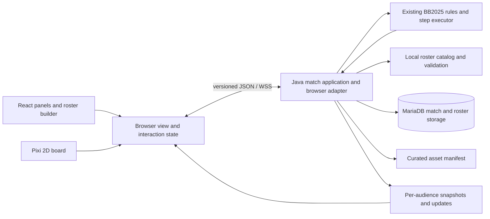

# Introduce application seams around the existing rules engine

Status: accepted by the owner on 2026-09-06. [Acceptance and source](../../.notes/overhaul-analysis/04-technology-and-decisions.md#adr-004-application-seams-not-an-engine-rewrite-prerequisite) · [September 6 revision](https://github.com/the-grognard-codes/moles-under-the-pitch/blob/120dd9953a71d7b0bff031c751feffae7f55b5f8/.notes/overhaul-analysis/04-technology-and-decisions.md#adr-004-application-seams-not-an-engine-rewrite-prerequisite)

## Amendments and follow-up

- 2026-09-23. [ADR 0001](0001-active-match-publication.md) assigned live viewer enrollment, access checks and best-effort delivery to the publication module.
- 2026-09-25. The board shown in the original diagram moved to DOM/SVG under the [browser stack amendment](0011-browser-stack.md#amendments-and-follow-up).
- 2026-09-27 and 2026-10-22. [ADR 0002](0002-bounded-match-transcript.md) defined durable action acceptance and the public transcript. [ADR 0004](0004-durable-recovery-journal.md) replaced single-blob storage with journaled native continuations.
- 2026-11-09. [ADR 0006](0006-single-engine-worker.md) specified single-worker ownership and bounded blocking I/O.

## Original decision, 2026-09-06

Decision status: **accepted**.

Proposed boundaries (names are conceptual, not existing APIs): `MatchApplication` authenticates and validates a player's intent; `RulesSession` invokes the existing sequence/step engine; `RosterCatalog` supplies immutable versioned position data; `TeamValidation` computes legality and cost; `MatchRepository` stores supported recovery state; `GameViewProjector` emits only recipient-appropriate fields. Side effects at start/end are routed through lifecycle adapters. Introduce seams where a traced dependency requires them; do not mechanically extract every class first.

Preserve one-at-a-time match mutation initially. Keep the current single communication queue until load testing demonstrates a need to partition it. A per-match actor can be a later scalability change; introducing it now would create additional concurrency behavior to verify.

Keep current snapshots/replay format behind a repository interface initially, with a pinned engine/replay version. Validate restoration while a decision is pending. A future canonical event log may improve long-term replay, but is not required to prove browser viability. Do not equate recorded UI commands with a stable domain-event schema.
