# Gatehouse scale and colour studies

## Full stadium at kickoff

The gallery opens on the 22-player kickoff with all 15 seating bays populated. Home supporters face right along the west touchline in navy and gold. Visiting supporters face left from the east touchline in Orc red and gold. The pie carrier, elder with the tankard and chestnut seller keep their neutral outfits on either side.

Three pointed lion standards hang from the north wall, and each side bay has a pole pennant projecting toward the pitch. The visiting pennants carry the Orc tusk on red. Ten cloth swags dress the north and south parapets. Four small lion shields hang on the two corner towers and the stone jambs of the south gate.

| Stand | Occupied places | Neutral outfits | Standing supporters |
| --- | ---: | ---: | ---: |
| North | 41 of 62 | 14 | 4 |
| West · home | 57 of 86 | 19 | 5 |
| East · away | 57 of 86 | 19 | 4 |
| South | 38 of 57 | 12 | 4 |
| **Whole stadium** | **193 of 291** | **64** | **17** |

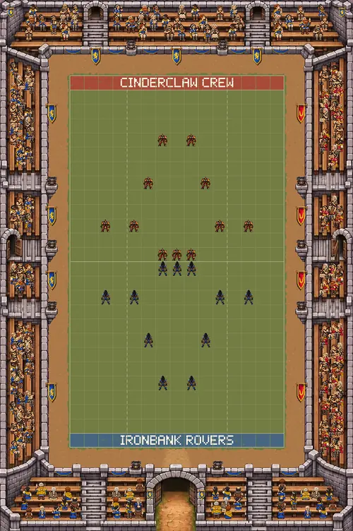

### Painted end zones

The visiting Cinderclaw Crew defend the north end. The home Ironbank Rovers defend the south end beside the gate. Both team names read upright from the overhead camera. The colours follow the team defending each goal, independently of the home supporters in the stands behind it.

Each end zone is one playable row, 15 squares wide. The paint mixes equal parts team colour and turf colour. Small worn patches expose the underlying grass, and occasional nicks along the edges of the letters reveal the paint beneath. Each end has its own wear pattern that stays in place when the kits change. The square divisions and goal lines run over the paint.

The renderer chooses ivory or charcoal lettering by measuring its contrast against the painted surface. The lowest contrast on intact paint across all 16 primaries is 4.52:1. The names still distinguish the ends when both kits use the same navy.

The three pairs below show the default kits, white/black, and identical navy at native resolution. In each pair the north end is above the south end. Switch off **End zones** in the full-stadium gallery to compare the paint with the original grass.

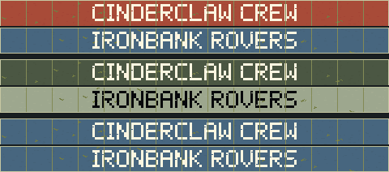

### Regalia at pixel zoom

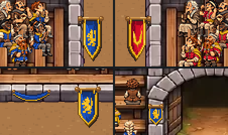

The detail plate shows the native pixels at 2×. In the gallery, **End zone and regalia colors** switches the ornaments and field paint between the default team kits, white/black, yellow/violet, similar blues, and identical navy. Fixed hardware retains its colour, and the fittings stay on the stone. Switch off both **Regalia** and **End zones** to see the undecorated kickoff. [Undecorated kickoff](https://github.com/the-grognard-codes/moles-under-the-pitch/blob/0b7ec30240629cf56a3525c3fdb951e69d0f913d/assets/game/references/stadiums/scale-studies/kickoff.webp)

Open `/stadium-mockup?view=full-bowl` and select **Inspect a bay** to compare the native and 4× views. West bay 6 preserves the approved six supporters and their contacts on the original nine seats. East bay 10 shows the same bench scale with a different group facing inward. Bays 7 and 11 show how the crowd fills the long terraces beside the south gate.

All eight side inserts were checked before any overlap or timber cutouts. In the undecorated kickoff they cover 48,806 pixels. Compositing just those inserts over the earlier end-stand kickoff reproduced the undecorated gallery canvas pixel for pixel. The height order keeps faces, held objects and standing soles visible. A near-level pair can swap drawing order when their boot baselines differ by at most one native pixel.

## North and south stands at kickoff

The earlier end-stand review shows both end stands populated and eleven players per team. Home supporters wear the Human navy and gold kit. The halfling with the pie, the elder with the tankard and the chestnut seller wear their fixed neutral outfits. [Previous end-stand kickoff](https://github.com/the-grognard-codes/moles-under-the-pitch/blob/3904fe1c2affb2c1b64e9c984ec2cd67ed55040d/assets/game/references/stadiums/scale-studies/end-stands/full-ends/kickoff.webp)

| End | Occupied places | Neutral outfits | Standing supporters |
| --- | ---: | ---: | ---: |
| North, facing the viewer | 41 of 62 | 14 | 4 |
| South, facing the pitch with their backs to the viewer | 38 of 57 | 12 | 4 |

The north back row adds 20 places across the three bays. Thirteen are occupied, from left to right in groups of three, seven and three. Each bay mask extends 20 native pixels up the rear wall and tapers at the arches. The supporters on this row are seated, with their hips on the original timber at stadium y=32. The earlier crowd, the stair entrances and the pitch retain their original positions.

Open `/stadium-mockup?view=full-ends` and select **Inspect a bay** for the native and 4× crops. North bay 2 includes the centre benches and their stairs. South bays 13 and 14 flank the gate. **Seat markers** shows occupied contacts and the gaps reserved above standing supporters. Each crowd insert has the dimensions and origin of its seating bay. The full-resolution browser comparison checks the seven inserts, the surrounding architecture and the kickoff formation against the native canvas.

## Complete north and south cast

Open `/stadium-mockup?view=end-poses&group=seated-a` for the new seated supporters. **Pose group** switches both ends of the stadium together. Each group shows three of nine places occupied, with a blitzer for scale and a 4× view for inspecting the silhouettes. [Artist sheet of all 24 drawings](../../assets/game/references/stadiums/scale-studies/end-stands/cast-angles.webp)

| Group | Supporters |
| --- | --- |
| Horn, clap and pie | Approved dwarf, clapping supporter and halfling |
| Tambourine, lookout and mug | Tambourine player, lookout shading his eyes and elder with a wooden tankard |
| Program, whistle and chestnuts | Elf reading a match programme, whistle player and chestnut seller |
| Cheer and standing supporters | Seated supporter raising a fist, standing tambourine player and standing dwarf raising his horn |

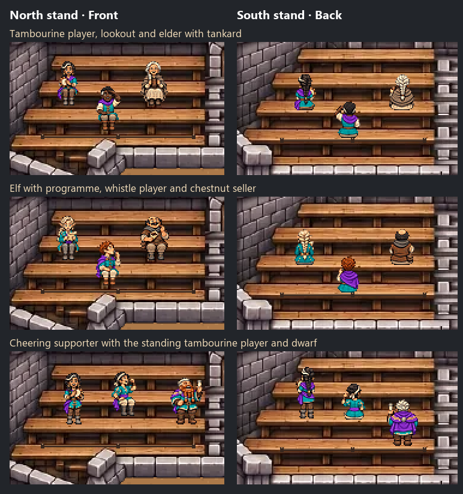

The ten supporters have ten seated poses and two standing alternates at each end. The halfling, elder and chestnut seller wear neutral clothing throughout. Each seated rear silhouette meets the timber in one continuous curve. Each standing figure has two separate soles on one plank with room above for the full figure. Pixel checks cover all 24 poses under contrasting and identical kits, and the approved three pairs and their gallery inserts still match the original.

## North and south · 33% attendance

Open `/stadium-mockup?view=ends` to see the same three seated supporters from opposite ends of one pitch. The north stand shows their faces, knees and feet. In the south stand their backs face the viewer, and the rounded seat of each supporter’s trousers rests on the timber. The clapping supporter turns her head a little toward midfield in both views. The dwarf watches straight ahead with his horn, and the halfling holds his pie. A blitzer at each goal line provides a game-scale reference.

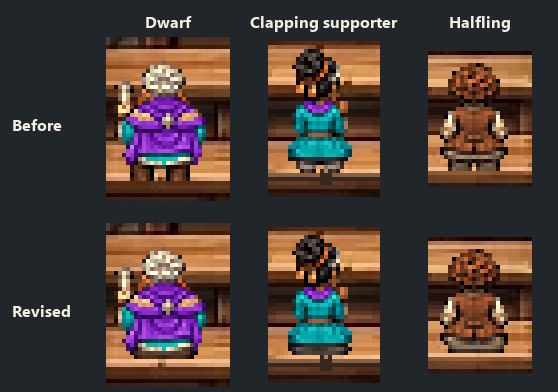

Each bay in this earlier study has three of nine places occupied, including one fixed neutral outfit. North bay 1 uses five and four places on its two inner planks. South bay 12 uses three planks with three places each. **Seat markers** shows the occupied and vacant places. **Front rail** toggles the separate rail. **View six full poses** opens the transparent drawings so the silhouette of each seated figure can be inspected on its own. [Artist sheet](../../assets/game/references/stadiums/scale-studies/end-stands/artist-reference.webp)

The seating checks validate the complete source against its bay mask and require the rear seat contour to remain on its plank. Native and 4× browser comparisons showed that the revision changes only the three rear seat areas with the rail visible or hidden. The west-facing cast supplies the side-view reference for later stands.

## West bay 6 · Crowd density review

West bay 6 has nine seats arranged across three benches. Select its 66% study for two supporters on each bench, 100% for all nine places, or 33% for one supporter per bench. The same blitzer stands at the touchline in every view for a game-scale comparison.

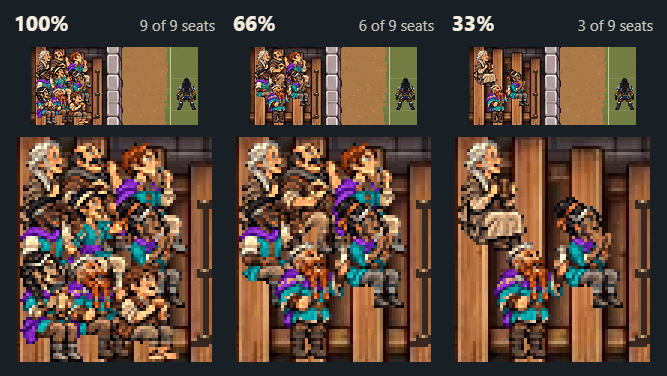

The new west-facing cast has ten seated poses and two standing alternates. Seven supporters wear two team-colour materials. The halfling with the pie, the elder with the tankard and the chestnut seller wear fixed neutral clothing. The light olive-brown tambourine player, medium-brown clapping supporter and deep-brown lookout keep their skin tones under either kit. The transparent artist sheet records the faces, clothing and props for future views. [Artist reference](../../assets/game/references/stadiums/scale-studies/bay-six/cast-reference.webp)

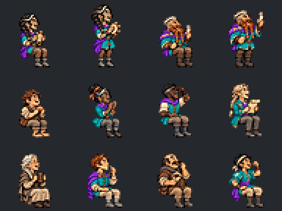

| Gallery view | Occupied seats | Supporters per bench | Neutral outfits |
| --- | ---: | ---: | ---: |
| A · 100% full | 9 of 9 | 3 | 3 |
| B · 66% full | 6 of 9 | 2 | 2 |
| C · 33% full | 3 of 9 | 1 | 1 |

All nine supporters in the full bay keep the seat they occupied in the approved cast preview. The dwarf sits when the bay is full and stands to raise his horn in the other two views, where the seat above him is vacant. At 33%, the elder, dwarf and clapping supporter occupy different positions along their benches.

Open `/stadium-mockup` and use **Gallery view** to change attendance. Returning fans keep their seats and clothes. Compare the views at native size and 4×, or scroll down to see the whole pitch. **Seat markers** shows empty places as grey squares, hip or foot contacts as cyan crosses and seated knees as gold dots. **Inspect full poses** shows each occupied seat in its assigned kit before overlap. **Inspect all 12 poses** shows the entire cast, including both stances for the tambourine player and the dwarf.

Turn off **Front rail** to inspect how each plank covers the back of a seated calf. This detail from the bench-fit proof shows the effect on the folded-arms pose.

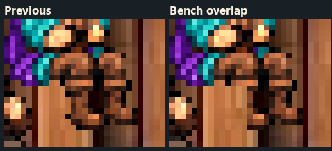

Enable **Bench tops** in any gallery view to highlight the 64 individual planks. In **Empty stadium** this shows the full layout for a stadium artist. With a west-bay crowd selected, combine **Bench tops** and **Seat markers** to inspect hip and boot placement. The gallery and the crowd builder read the same [reusable bench geometry](../../assets/game/references/stadiums/scale-studies/gatehouse-benches.json).

## Empty Gatehouse

Open the development gallery at /stadium-mockup. **Empty stadium** shows the permanent timber terraces, access stairs, cold braziers, bare sidelines and south gate in the reference palette. **Show seating masks** identifies 15 bays. Teal marks home seating, and pink identifies the four bays on the east side. Each bay has its own integer ID in the native mask. The [bay dimension manifest](../../assets/game/references/stadiums/scale-studies/empty-seating.json) records the native origin, width, height and pixel count of each bay. The [fit checks](../../assets/game/references/stadiums/scale-studies/README.md) use the approved pixel outlines, including their cutouts.

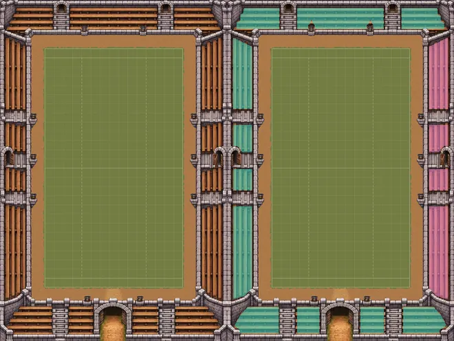

## Earlier gallery rounds

Open `/stadium-mockup` in the development gallery. From `browser-client`, run `npm run dev:stadium` and use the address printed by Vite.

The original review compared a reconstructed stadium to its painting. That established fidelity but missed the scale mismatch visible when a player stood near a barrel or a supporter. These studies put a touchline player and adjacent opponents in the same crop.

| Study | Player artwork | Sideline |
| --- | --- | --- |
| A | Original size | Approved Gatehouse |
| B | 125%, scaled about the planted feet | Same as A |
| C | 125%, same placement as B | Smaller spectators and props, drawn at pitch scale |
| D | 125%, same placement as B | Densely populated painted terrace with smaller faces and a dirt apron |

Compare A and B at the line of scrimmage to see how much room the larger figures leave between adjacent squares. Compare B and C at the touchline to judge the height of the supporters, benches and barrels. The playing grid stays at 32 native pixels per square.

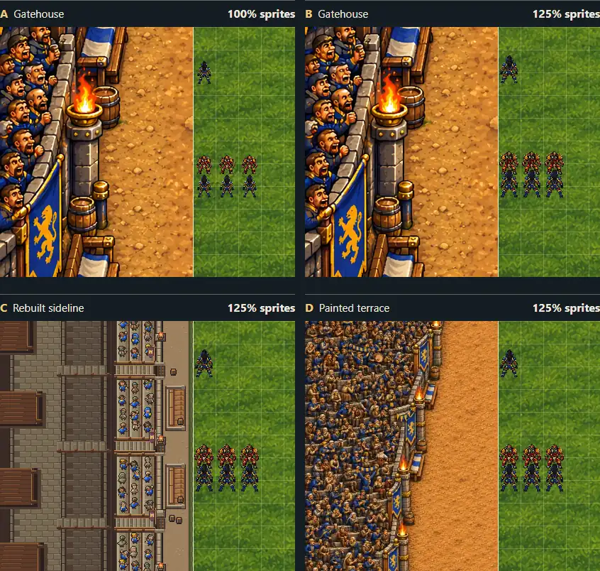

### Material design

The new sideline starts with a transparent silhouette and explicit material assignments for tunics, hats and cloth. Skin, wood, iron, masonry, outlines and fixed neutral clothes have separate identities from team fabric, even when two materials happen to look similar in one colour scheme. Each fan gets a wardrobe assignment. Each bay has 12 supporters. Four wear fixed clothing, for a total of 16 out of 48. The other supporters use primary and secondary ramps with four shades each. The full strip and isolated figures share the same binary alpha at every figure edge.

Use the edge inspection view to check gaps between arms and bodies and the silhouettes of small props against light, dark and checkerboard backgrounds. Change the kits to inspect which surfaces follow the primary and secondary ramps. A good proof has clean edges, visible folds on both light and dark kits, and stable neutral clothing.

This is an overhead scale decision. The existing full Gatehouse gallery remains available for comparison. A full stadium redraw depends on the selected player and sideline scale.

Study D explores how the smaller figures read in Gatehouse’s painted style. Its 272 × 352 pixel terrace is a centred, downsampled crop of a newly generated 1070 × 1470 painting. Its crowd colours are baked into the concept. Study C is the working proof for recolouring and alpha. If D is selected, author its figures and fixtures separately with C’s material rules before assembling a full stand.

### Study E · Stepped Gatehouse bowl

The west touchline and the whole overhead bowl use the same 32-pixel grid. The playable field measures 15 by 26 squares. The inner wall sits 48 pixels (1½ squares) outside the chalk on all four sides. Uneven grass clumps extend 2–7 pixels into that dirt. The muted green turf has a sparse, low-contrast texture.

The new painting uses raised stone rows, heraldic pennants, doublets, mail and leather. Spectators are slightly larger than D and mix team colours with neutral clothing. The crowd is still painted in this review. For the production redraw, reserve both cloth ramps and assign fixed wardrobes to roughly one supporter in three using C’s tested method.

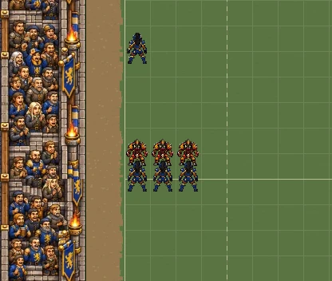

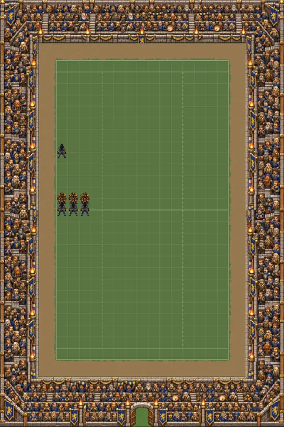

### Study F · Inward-facing Gatehouse bowl

The south supporters show their backs as they watch the pitch through the same overhead camera. The red-and-ivory away section occupies the east terrace, with cross-aisles descending through the seating bays toward the pitch. The other three terraces use home colours mixed with neutral clothing.

The entire stadium surround is one newly drawn foreground with a transparent opening. Its pointed standards, stonework and braziers extend over the dirt on their own silhouettes. The west crop uses the same players, turf, grid and apron as E. The bowl view selector also has native-size crops for the south gate, east away terrace and north banners. The gallery now draws individual spectators over the terraces. The 12 poses include cheering, drinking, eating, pointing, clapping and watching quietly. Of the 540 seats, 181 are assigned neutral wardrobes. The home and away primary and secondary ramps drive only the indexed clothes and heraldry. The south gates open directly onto the earth apron and the shaggy edge of the muted turf.

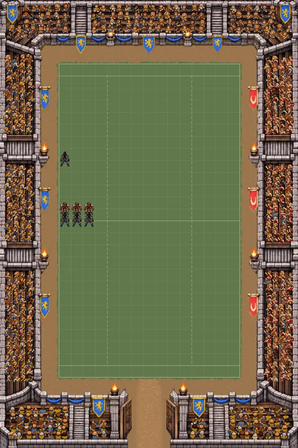
The two north-stand captures use the default and white/black kits. Hands, faces, neutral clothing and food keep their drawn colours.

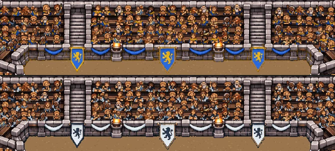
