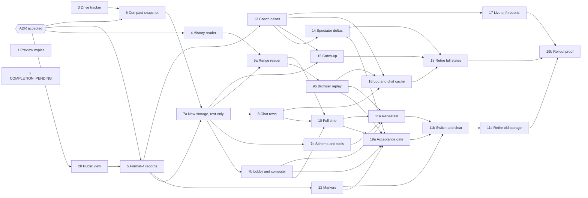

# Handoff: implementation plan for match state, history and live sync

Issue: [#651](https://github.com/the-grognard-codes/moles-under-the-pitch/issues/651)

Parent: [#611](https://github.com/the-grognard-codes/moles-under-the-pitch/issues/611) ([ADR request](match-state-sync-adr.md)). Measurement: [#650](https://github.com/the-grognard-codes/moles-under-the-pitch/issues/650) ([spec](match-state-sync-measurement.md)).

Status: revised again on 2026-11-25 after [Codex's review of the ADR draft](https://github.com/the-grognard-codes/moles-under-the-pitch/pull/655). First revised on 2026-11-24 after [Codex's review](https://github.com/the-grognard-codes/moles-under-the-pitch/issues/651#issuecomment-7146170290). The maintainer accepted the recommended answers to its questions, recorded as decisions 14–20 in #611. Decision 21 was added later that day, and decisions 22–30 on 2026-11-25. Tickets 1–3 are filed (#652, #653 and #654). The other 23 are candidates, filed when the ADR is accepted. Line numbers are at `main` `eb5057d02`.

## Goal

Every match costs the same to play late as early: durable write, restore, live update and full time. Today restore, compaction and full time carry the whole match, and each live update carries the whole state. #611 holds the decisions and the evidence. This plan turns them into work.

## What the review changed

| Finding | Where it is now |
| --- | --- |
| 1. A later small update can replace the one a browser still needs (`PublicationDelivery.java:50-57`) | Gap detection and snapshot repair are in ticket 13 |
| 2. Saves, chat and timers change stored data without a new gameplay revision | The storage generation below; tickets 5, 7a and 8 |
| 3. Expiry isn't a finished match, and a digest over all records grows with the match | Ticket 10 leaves expiry alone; the running digest is in tickets 7a and 10 |
| 4. Screens depend on the list of legal actions (`GameView.tsx:1136`) | New ticket 20 defines the public view first |
| 5. The cutover could come before the markers and the proof | Ticket 11 is split; 11b needs 12, 19a and 11a |
| 6. Comparing the newest record can't find one missing from the middle | Tickets 7a and 9a; a separate audit in 10 |

Tickets 7, 9, 11 and 19 are split. The old numbers keep their letters, so the review still reads against this plan.

## What the tickets assume

Decisions 14–30 in #611 govern. The review kept these working assumptions, and the maintainer accepted the first four (decision 28):

- **Patches** replace whole players and whole top-level public sections. Keyed players support insertion, removal and a stable order. A section that ends is removed explicitly, which is different from unchanged and from `null`.
- **One writer per match.** Each match's storage version is chosen at activation and stored with the unpublished activation seed and the revision-zero record, so a crash or a changed setting reopens the same seed. The new storage is test-only until chat, replay, expiry and full time work. Nothing is written in both formats.
- **Row summary.** The current-state row always carries a small summary, bound to the storage generation, with absolute expiry times and maintenance inputs.
- **Tests move in batches:** unchanged characterization of the old storage; the same repository cases against both storages, with MariaDB (#578); shared Java and TypeScript protocol fixtures; browser role, recovery and playback; then a mixed-version rehearsal.
- **Ownership.** When a ticket is filed, it takes its readers and writers from the ownership list in Codex's review, including `BrowserV2Adapter`, `JdbcMatchRepository`, `V2PreparationService`, `BrowserRequestTiming`, the recovery fixtures and the soak driver.

## What each operation writes

Accepted as decisions 24 and 26. Three counters stay separate: the **storage generation** (compare-and-swap), the **gameplay revision** (one record each), and the **chat index**. A staged placement's sequence is transient.

| Operation | Record | Generation | Chat row |
| --- | --- | --- | --- |
| Activation seed | Revision 0, with a keyframe | Yes | No |
| Accepted decision, confirmed stage, declined or timed-out reaction, concession, full time | Yes | Yes | No |
| Refused setup without staging | No; a receipt with the errors | Yes | No |
| Save and resume steps, proposal expiry, abandonment, decision-clock maintenance | No | Yes | No |
| Chat message | No | No | Yes |
| Staged placement, staged refusal, load, exact retry | No | No | No |

Live messages need their own order for changes at one gameplay revision, so that a browser doesn't discard a valid save update.

## Numbers from #650

Keyframe cadence, the size of the in-memory tail and the numeric targets are the budgets in the ADR draft (PR #655, decision 29).

## Dependencies

The longest chain is 20, 5, 7a, 7b or 9a, 10, 19a, 11b, 11c and 19b. The gate (19a) also needs tickets 13 and 14, because it measures the real coach and spectator path (decision 30). Ticket 13 needs ticket 5 and works for matches in either storage, so coaches can see smaller updates before the cutover.

## Filed now

### 1. Preview copies leave the game log out

Filed as #652. Block and ball-transfer previews stop copying the native game log with the engine.

### 2. Remove `COMPLETION_PENDING` handling

Filed as #653. The browser and the computer player stop handling a code that the server no longer sends.

### 3. The drive tracker keeps its own summary

Filed as #654. The transcript stops owning presentation state, and the tracker takes current facts rather than stored records.

## Public view

### 20. Screens use a defined public view

**What it delivers:** The server builds one public view from an explicit allowlist, and the screens of the waiting coach, spectators and replay work from it.

**Blocked by:** ADR accepted.

- The public view keeps player, team and ball facts, score, phase, weather, revealed outcomes, who must decide and what kind of decision it is, phase gates, the pass range and Kick options shown on the pitch, movement, dice and save status (decision 14).
- The other coach's actions, prompt IDs and options, movement forecast, player action menu, block preview, threats and saved formations are outside it. `computer` stays on the computer channel.
- Who must decide comes from an authoritative source, not from the first available action (`SetupSession.java:1458`).
- A waiting coach and a spectator with no actions see the normal waiting text, not "Reconnect if the match appears stuck". The waiting coach's read-only range inspection still works.
- Accepted decisions and native outcomes have an allowlist too. Today the recorder copies the request and removes only `computerDecision`.
- The maintainer approves the exact field list before the view is used (decision 27).
- Parity fixtures from today's screens cover both coaches, a spectator and replay, including privacy-negative cases. Related: #487.

## Storage and replay

### 4. One reader for match history

**What it delivers:** A prefactor. Result metadata, the final state, the turn index, keyframes and record ranges are read through one bounded interface, backed by today's artifact.

**Blocked by:** ADR accepted.

- The interface has no method that returns the whole artifact. Access checks, the old-format fallback and full old-format validation stay.
- Where `events` and the transcript hold the same board, readers use the transcript.
- Stored formats and behaviour don't change.

### 5. Format-4 records rebuild a match exactly

**What it delivers:** For each committed revision, the server can build a record (decision, ordered outcomes, `presentation` field, public patch) and periodic keyframes, starting with one at revision zero. The revision-zero record is a patch from an empty view.

**Blocked by:** ticket 20; ADR accepted.

- Over complete headless matches with both rosters and several seeds, the browser's own reducer reproduces the server's independent public state at every revision.
- The cases include the ball disappearing, a player leaving the pitch, and `passing`, `kickoff`, `activePlayerAction` and `blockContext` ending.
- Decoding is strict and versioned, and marker identities are stable. BB2025 mapping stays behind the shared record types.
- The projection is built once on the engine worker, after native resolution and before the transaction, and computes no actions, forecasts or previews. Nothing private enters a record or keyframe.
- Save status, reaction deadlines and clocks travel as ordered status updates with time anchors and their storage generation, not as record or keyframe data. A save and a resume at a keyframe's revision cause no drift report and no rollback when the keyframe is applied. Staged and provisional moves stay overlays on the committed state.
- A test fails if a field of the recorded view changes without appearing in a patch. The parity checks cover the recorded view. A save at a keyframe's revision changes the live status with no patch.

### 6. A match restores from a compact snapshot alone

**What it delivers:** A session exports a snapshot with no history, and a session restored from it continues exactly where it was.

**Blocked by:** ticket 3; ADR accepted.

- The snapshot carries everything under "Restore snapshot" in #611, with the absolute command number, the last captured command, the decision-limit and drive counters, the unfinished movement narrative, the phase, announcement and block cursors, clocks, save/resume state and computer memory.
- With the native log omitted, the next command numbers, dice, outcomes, choices and both coaches' views match a session that was never restored, including at pending routes, reactions, cleanup and suspension. A crash during a stage is compared with the committed state.
- Captured commands are discarded only once the write is known to be durable. A failed or unknown write releases the session.
- Rebuilding the match uses the snapshot alone, and no event, record, request history or game log. The bounded tail check in ticket 7a is separate.
- After #652, the acting coach's reply is timed with the number of preview copies and the time inside them, next to #650's 245.8 ms.
- A size test reports absolute bytes, and fails if the snapshot at the end of a match is more than 25% larger than at revision 50 in a matched phase.

### 7a. A test-only match commits state, receipt and record together

**What it delivers:** A match activated with the new storage, in tests only, plays, survives a restart and can be retried. One transaction updates the current-state row and appends the receipt, the record and any keyframe.

**Blocked by:** tickets 5 and 6.

- Compare-and-swap uses the storage generation. Appends are contiguous and unique. Same-revision writes are covered.
- Receipts are private rows found by match, actor and request ID, with the fingerprint, accepted revision, code and any error details (decision 15). Tests cover two devices on one seat, a cold restart, the computer player's retry, a timed reaction for the same role, and a reused ID with different content. The limit of 256 save requests stays as it is.
- The running digest is updated in the same transaction (decision 17).
- Restore checks the generation and the newest 32 records, or all of them if fewer, against the snapshot's gameplay revision in one consistent read. Tests cover all records missing, the last one missing, a gap, and a generation ahead of the records. Older history isn't read.
- After an unknown commit, a bounded reconciliation runs without another request, and repairs connected, authorized viewers. It reads under the match row's lock, and a lock timeout stays unknown. Tests cover both outcomes with the acting coach gone, a first probe that starts on a second connection while the original writer still holds the row, for a commit and for a rollback, and a compare-and-swap loser across two devices. The receipt is checked before a stale or completed refusal, and the losing candidate is never published.
- MariaDB tests cover commit, rollback, an unknown outcome, an exact retry, a stale retry, and process death before and after commit. Nothing is published before commit.
- The [retained-move acceptance case](https://github.com/the-grognard-codes/moles-under-the-pitch/issues/611#issuecomment-7122189387) passes, and the write and restore targets are met.
- Limits for a record, keyframe, snapshot and receipt are defined here, with evidence that every legal outcome fits. Storage admission reserves for them and rejects before native execution.

### 7b. The lobby and the computer coach work with both storages

**What it delivers:** Lobby listings, the computer dispatcher and resident-match admission handle matches in either storage.

**Blocked by:** ticket 7a.

- The lobby reads the summary without decoding the snapshot, and expiry, resume deadlines and account dismissal are unchanged (#639, #643, #644).
- A parked computer coach gets "nothing changed since revision N" without a snapshot (decision 18), only when its last seen storage generation matches and nothing is due. Otherwise every condition of `RecoveryCheckpoint.computerReply` is evaluated again, and it gets the full reply when that can't be certified. Tests cover a proposal, a suspension and due maintenance at one revision.
- Each state write stores an indexed `playable_until`, as in the ADR. Tests cover a proposal or reaction deadline earlier than, equal to and later than retention, suspension, and cold rows, against the lobby's rule. An expired match can't become playable again.
- A committed human move, a save or a resume still wakes the computer, and saved matches still leave the inventory.

### 7c. The schema and the operations tools cover the new tables

**What it delivers:** Additive tables, and tested backup, restore, parity, provisioning, clearing and schema verification, before any real match uses them.

**Blocked by:** ticket 7a.

- Schema marker 12 is additive, with a stated rollback. The server still refuses an unexpected schema.
- Each tool is identified as current or archived. `tools/r5-backup-lib.mjs` is pinned to marker 6. A supported backup and restore path for the new tables is rehearsed.
- Clearing handles foreign keys and interrupted MariaDB DDL, and keeps accounts, teams, memberships, expired acknowledgements and settings.

### 8. Chat is stored as rows

**What it delivers:** Each chat message is a row. Sending one doesn't rewrite the match.

**Blocked by:** ticket 7a.

- The chat rows own the index and the 512 limit. The transaction locks the match row that gameplay and full time write, and takes the message's revision and index under that lock. The storage generation doesn't move (decision 24).
- Tests cover both commit orders against full time, a retry after sealing, and message 512 followed by an eviction and a reload. A join or repair carries the chat watermark.
- Author and request ID stay unique, including after the match ends. Rate, length and the 512-message limit stay (decision 20). Spectator numbers stay stable after a reconnect.
- Pages are read by index, without scanning earlier messages or decoding the match. Chat never invokes a game command.

### 9a. Records and keyframes are read by range

**What it delivers:** The server returns a starting keyframe and the records after it, and one shared reducer in the browser rebuilds each state.

**Blocked by:** tickets 4 and 7a.

- A read fails closed on a gap. Reading the first, middle and last part of a match costs the same at any length.
- A terminal fixture is used until ticket 10 produces a real finished match. An old-format match still opens through ticket 4's reader.
- Only participants can read a finished match's result and replay, as today. An authorized spectator of a registered match can still read its public history, with the recorded view only. Tests cover a connected spectator catching up after sealing, revoked access, and that no offers or result data are served.

### 9b. Replay, results and the match log use ranges

**What it delivers:** A coach opens, seeks, steps and pages a match without the browser loading all of it.

**Blocked by:** ticket 9a.

- The log handles sparse pages. Today's history only accepts a prefix from zero (`transcript-history.ts:20`), and the result screen builds its turn list from every record.
- Playback, the match log, dice and the turn list show the same as today.

### 10. Full time finishes a match without building it

**What it delivers:** Full time and concession store the result as the final state, the records and the sealed running digest.

**Blocked by:** tickets 7b, 8 and 9a.

- Expiry and abandonment don't change: the match stays activated, the lobby derives its status, and dismissal stays per account. Their records are kept (decision 23).
- The result, the prepared match's lifecycle and the terminal state change together, or each intermediate state is recoverable to the same result after a restart.
- An unknown terminal commit reaches the waiting opponent without another request, including when the first probe starts while the terminal writer still holds the row. Tests cover regular full time, a concession, a retained concession from an incompatible session, refusal before commit, an unknown commit either way, conflict, process death after commit, deferred completion, timer-driven completion, and the old size-limit stop. No second record or concession appears.
- The digest covers the records in order, with defined bytes, and not keyframes or chat (decision 25). The audit rebuilds keyframes, including revision zero's, from the records alone. A separate audit detects a deleted, changed or reordered record.
- A finished match keeps all its records (decision 21). The limit of 1,024 matches held for recovery (`JdbcRecoveryRepository.java:31`) counts only matches that can still be played (decision 22). Tests at the limit finish a match, abandon a match, and let a match expire without anything recording it, and each then activates another. The count uses ticket 7b's `playable_until` under serialized admission. Tests also cover a renewal whose commit is still unknown at the deadline, and a clock set back in the running server and before a restart.
- The quarantine journal, its cooldown and the admission guard stay.
- Finishing meets the full-time target, with the same cost early and late.

### 11a. Rehearse the cutover

**What it delivers:** A rehearsal, on a copy, of the schema change, mixed reads, backup and restore, a game-only clear, and a paired build and database rollback.

**Blocked by:** tickets 7b, 7c, 9b and 10.

- Memberships, expired acknowledgements, accounts, teams and settings survive. The recovery point for writes after the backup is stated.

### 11b. Switch to the new storage and clear old matches

**What it delivers:** New matches use the new storage, and the maintainer clears all existing matches: active, saved and completed.

**Blocked by:** tickets 11a, 12 and 19a.

- The switch happens with the gate's evidence, on the maintainer's word.
- Old stored data is refused with `RECOVERY_UNSUPPORTED`.

### 11c. Retire the old storage

**What it delivers:** The journal, compaction, `events`, the request history, the game-log freezing and the completed-result size limits are gone.

**Blocked by:** ticket 11b.

- `MATCH_SIZE_LIMIT` and the memory budget are removed or restated. Every 8,192 and 8,193 bound, on the server and in the browser, changes together.
- The diagnostics fields, capture tools and analysis scripts are adapted or deleted.
- The architecture map, the `CONTEXT.md` terms and the operations guides match.

### 12. The server fills in ADR 0007's markers

**What it delivers:** Each record carries its ordered phase markers.

**Blocked by:** ticket 5. #603 settles the touchdown order first.

- Every emission site in the phase inventory is covered or has its own ticket.
- Markers and the phase cursor are the same live, after recovery and in replay. An exact retry adds none.
- Browser scheduling by markers and the remaining inventory gaps have a named owner. Coordinate with #547, #588, #647, #648 and #649.

## Live updates

### 13. A coach plays on deltas

**What it delivers:** A browser that negotiates it receives, for each accepted move, the record and its own role's envelope instead of the full state twice. It can always repair itself.

**Blocked by:** ticket 5.

- Every request still gets its own reply, even if the record is over 256 KiB or can't be queued.
- The browser checks the match and the base revision, and detects duplicates and gaps. A replaced or dropped update always leads to a bounded, authorized snapshot, including when no further move follows and when the repair read itself fails (#519).
- A snapshot and a page state the revision they start from, so nothing is applied twice. Joining and reloading get a snapshot and the latest page. The browser keeps the applied state and the last presented record as separate cursors, so playback continues across a repair without repeating or skipping a move, including when the base has left the tail. Until ticket 15, the missing records come from today's paged transcript for an old-format match, and from ticket 9a's range reader for a format-4 match, which exists before any real match uses format 4.
- Envelopes carry only that role's offers. Access is rechecked when an update is queued and after it was deferred. Publication still follows the commit, and staged placements keep their order.
- Tests cover two rapid moves from different coaches, two devices on one seat, a slow connection, revocation during deferral, a reconnect with an unresolved move, and a terminal update with no later frame.
- It works for matches in either storage. Bytes per move are reported against #650's baseline.
- A test and the soak check the browser's applied state against the server's (decision 19).

### 14. Spectators watch on deltas

**What it delivers:** Spectators share one serialized public update per revision.

**Blocked by:** ticket 13.

- A spectator gets the public decision and splash cues and never a coach's envelope.
- Access is rechecked when queued and after deferral. Tests cover watching, revocation, rejoining, viewers with and without the capability, and saved formations during setup (#487).

### 15. A browser catches up from records

**What it delivers:** After a short gap, the browser gets the records it missed instead of a snapshot.

**Blocked by:** tickets 7a and 13.

- The tail is bounded in records and in bytes. Records come from the tail or from stored rows, without restoring the match. A viewer in forward playback whose base is outside the tail gets the missing interval from stored ranges.
- Tests cover duplicates, overlaps, a stale base, cold and finished matches, and the role's current status at the end.

### 16. The match log and chat are client caches

**What it delivers:** The browser keeps the log and chat it has received, and fetches older pages when they are needed.

**Blocked by:** tickets 8, 9b and 13.

- Caches are sparse and bounded, keep their place while scrolling, and handle overlapping pages.
- A cold join, reload, device switch and replay seek never fetch everything before them. Coordinate with #545.
- Neither the log nor chat is in the restore object or in a live state message. Caching across reloads in browser storage stays deferred.

### 17. Live drift reports

**What it delivers:** Keyframes are also sent live. The browser compares its committed state with each one, reports a difference, and adopts the keyframe.

**Blocked by:** ticket 13.

- Staged and provisional moves are left out of the comparison.
- A report names the match, revision, client build and bounded field paths, with no private values. It is rate-limited and logged as one line.

### 18. Retire full-state publication to browsers

**What it delivers:** Browsers no longer receive the full state on every move, and the duplicate live-transcript frame is gone.

**Blocked by:** tickets 14, 15 and 16.

- Every reader has moved, including the soak. A slow client and a stale tab recover. A browser without the capability is asked to reload.
- Full snapshots stay for joining and repair, and for the computer player.

## Proof

### 19a. Acceptance gate before the cutover

**What it delivers:** Correctness, latency and memory evidence on the complete new path, before any default changes.

**Blocked by:** tickets 7b, 9b, 10, 12 and 14.

- The targets are agreed first. The cutover waits on any correctness or budget miss.
- With the resident cache full, a large match finishes, both coaches read it, and another match is served meanwhile. The evidence reports rows and bytes, worker p99, queue wait, peak and retained heap at 768 MiB, and releases. This carries #593's queue stall, #594's full cache and #596's long human match.
- It runs on the production path, not a prototype, including delivery to both coaches and three spectators. It proves a repair outside the tail on the new storage. Limits for one record, page, tail and resident cache are verified. Ticket 7a defines the durable ones.

### 19b. Proof after the rollout

**What it delivers:** A sustained soak on the final code, compared with #650's baseline.

**Blocked by:** tickets 11c, 17 and 18.

- It uses #597's corrected soak method or equivalent evidence. Any miss has a ticket.
- It takes at least 100 restore samples and sets the p99 target for restore (decision 29).
