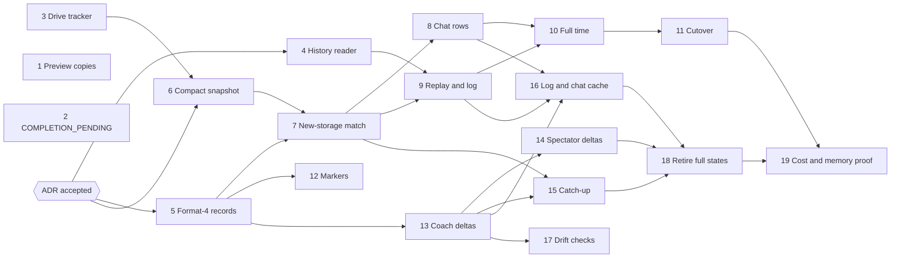

# Handoff: implementation plan for match state, history and live sync

Issue: [#651](https://github.com/the-grognard-codes/moles-under-the-pitch/issues/651)

Parent: [#611](https://github.com/the-grognard-codes/moles-under-the-pitch/issues/611) ([ADR request](match-state-sync-adr.md)). Measurement: [#650](https://github.com/the-grognard-codes/moles-under-the-pitch/issues/650) ([spec](match-state-sync-measurement.md)).

Status: handed to Codex for review by the maintainer on 2026-11-24. The nineteen tickets below are candidates and none is filed. The eight proposals are not decided until the maintainer settles the review. Line numbers are at `main` `eb5057d02`.

## Goal

Every match costs the same to play late as early: durable write, restore, live update and full time. Today restore, compaction and full time carry the whole match, and each live update carries the whole state. #611 holds the decisions and the evidence. This plan turns them into work.

## What to do now (Codex)

1. **Read** #611, #650, ADRs 0001, 0002, 0004, 0006, 0007, 0008, 0012 and 0013, and the invariants in the [architecture map](../agents/architecture-map.md). Your earlier notes are on [#550](https://github.com/the-grognard-codes/moles-under-the-pitch/issues/550#issuecomment-7086931992), and your retained-move case is on [#611](https://github.com/the-grognard-codes/moles-under-the-pitch/issues/611#issuecomment-7122189387).
2. **Check every ticket against the code.** Done when each of the nineteen has a verdict: keep, change, split, merge or drop, with a reason.
3. **Check every proposal.** Done when each of the eight has a verdict and, where you disagree, an alternative.
4. **Answer the questions below.** Done when each has an answer backed by `file:line`, or a statement of the prototype or measurement that would answer it.
5. **Look for missing work and wrong edges.** Done when you have walked every reader and writer of the recovery tables, the completed artifact, the transcript and the live state message, and each has a ticket or a reason it needs none.
6. **Post one comment on this issue** with the verdicts, the answers, and findings ranked by severity. Separate hard defects from judgement calls.

This review produces that comment and nothing else. Filing tickets, changing labels, writing code and accepting the ADR come later, and the maintainer decides each.

## Questions the review must answer

1. **What is public?** Each view carries `actions`, `prompt`, `movementForecast`, `passing`, `kickPreview` and `playerActionMenu` for every role, spectators included (`SetupSession.java:1176-1299`). The publisher strips only `computer`, `threats`, `savedFormations` and `blockPreview` (`ActiveMatchPublisher.java:200-203`). Which fields belong in the public patch, which in a per-role envelope, and what do the waiting coach's and the spectator's screens need?
2. **Do whole-entity patches cover everything?** Name any public field that isn't part of a player or a top-level section, or that depends on the caller's role.
3. **Can the snapshot leave the native log out?** Cover `lastCommandNr`, `nativeCursor`, command numbering and the log epoch, and what a restored engine needs from commands that were already captured.
4. **Two storages side by side (proposal 4), or an integration branch?** 43 server test files use `SetupSession`, 21 test files read events or transcript JSON, and about 32 browser test files build states or records. Which route is safer, and how should the test changes be batched?
5. **Is one receipt per role enough?** Consider two devices, the computer player, save/resume, chat, and a setup refused with errors.
6. **Does ticket 13 need only ticket 5?** Consider the acting coach's reply, staged placements, playback, slow connections and the 256 KiB live frame limit (`BrowserMatchTransport.java:30`).
7. **What does building a record cost the engine worker?** Say where on the worker the patch and keyframe are built, and whether that fits ADR 0006's p99 of 100 ms.
8. **What can go wrong at full time (ticket 10)?** Cover deferred and uncertain completion, retained concessions, abandonment, expiry, `MATCH_SIZE_LIMIT` and the quarantine journal.
9. **Is each ticket small enough for one session?** Tickets 7 and 9 look largest. Propose splits where they help.
10. **Can tickets 1–3 really start now?** Say whether any of them would have to be redone.

## Known weak points

- Sizes are estimates until #650 reports. Nothing here has been prototyped.
- Ticket 7 changes storage, recovery, the lobby, computer probes and the operations tools at once.
- Ticket 11 collects several closing jobs: the `CONTEXT.md` terms for match checkpoint, transcript and replay, the diagnostics fields (`events`, `journalEntries` and others in `BrowserRequestTiming`) and the capture tools. It may need splitting.
- Hosted migration is named only through the operations tools in tickets 7 and 11.

## After the review

1. The maintainer settles the proposed changes, and this plan is updated.
2. Tickets 1–3 are filed after the review is settled (maintainer, 2026-11-24).
3. The ADR is drafted with #650's numbers and accepted. Tickets 4–19 are then filed from the [feature template](../agents/feature-template.md).

## Suggested skills

- `to-tickets`, for the slicing rules: vertical slices, blocking edges, and expand–contract for wide changes.
- `codebase-design`, for the history reader and the storage seam.
- `domain-modeling`, for the glossary terms that change.

## Proposals the tickets assume

Each needs the maintainer's approval.

1. **Markers.** Format 4 defines ADR 0007's `presentation` field from the start, and ticket 12 fills it in. Existing matches are then cleared once.
2. **Patch shape.** A record lists each player, and each top-level public section, that changed, with its full new value. It holds no field-level differences.
3. **Receipt window.** The current-state row keeps each role's last mutating request and its result. An older retry is rejected as stale. The browser holds one unresolved mutation at a time (`v2-client.ts:180` at `main` `eb5057d02`), so it never needs more. Save/resume keeps its own bounded window (256 requests).
4. **One storage version per match, chosen at activation.** New storage is opt-in until the cutover, and no match is written in both formats.
5. **Order inside decision 7.** Records and the compact snapshot come first, then storage, then replay, then full time, then the cutover.
6. **Row summary.** The current-state row always carries a small summary, because the lobby needs one as well as the computer coach. This settles the turn-summary question without waiting for #650.
7. **Computer player.** It keeps receiving full snapshots on its private channel.
8. **Drift checks.** Ticket 17 exists only if the drift proposal in #611 is accepted.

## Waiting for #650

Keyframe cadence, the size of the in-memory tail, and the numeric targets. The tickets name them, and the values are filled in when the tickets are filed.

## Dependencies

The longest chain is 5 or 6, then 7, 9, 10, 11 and 19. Ticket 13 needs only ticket 5 and works for matches in either storage, so coaches can see smaller live updates before the cutover.

## Can start now

### 1. Preview copies leave the game log out

**What it delivers:** Block and ball-transfer previews stop copying the native game log with the engine. The previews themselves don't change.

**Blocked by:** nothing.

- Every preview result is unchanged in tests that cover block, blitz, jump-up block, multiple block, pass and hand-off previews.
- A test shows that a preview copy has an empty game log.
- The PR reports the time and allocation of one copy before and after, early and late in a full match.

### 2. Remove `COMPLETION_PENDING` handling

**What it delivers:** The browser and the computer player stop handling a code that the server no longer sends (from #548).

**Blocked by:** nothing.

- No source, test, soak driver or document treats `COMPLETION_PENDING` as a live code. Historical reports stay as they are.
- A completed match still shows full time in the browser, and the computer player still ends its work.
- `PERSISTENCE_FAILED` and `MATCH_OUTCOME_UNKNOWN` behave as before.

### 3. The drive tracker keeps its own summary

**What it delivers:** The transcript no longer depends on presentation classes. The drive tracker receives appended records and owns its current-drive summary (from #548).

**Blocked by:** nothing.

- `MatchTranscript` has no dependency on a presentation class.
- The summary can be exported and restored without reading records. Today's restore still rebuilds it, so stored formats don't change.
- The drive tracker shows the same result live, after recovery and in replay.

## Storage and replay

### 4. One reader for match history

**What it delivers:** A prefactor. Replay, the result page, match-log pages, the view after full time, retained concessions, the decision limit and completed-result validation read history through one interface, backed by today's artifact.

**Blocked by:** ADR accepted.

- No reader outside that interface parses `events` or the transcript JSON.
- Where `events` and the transcript hold the same board, readers use the transcript.
- Stored formats and behaviour don't change.

### 5. Format-4 records rebuild a match exactly

**What it delivers:** For each committed revision, the server can build a record (decision, ordered outcomes, `presentation` field, public patch) and periodic keyframes. Any keyframe plus the patches after it reproduces the public state.

**Blocked by:** ADR accepted.

- Over complete headless matches with both rosters and several seeds, the rebuilt state equals the server's public state at every revision.
- Building a record computes no actions, forecasts or previews, and no private data enters a record or keyframe.
- The record and patch types carry no BB2025-specific types.
- Staged placements create no record. A confirmed stage appears as final positions.
- A test fails if a public field changes without appearing in a patch.

### 6. A match restores from a compact snapshot alone

**What it delivers:** A session exports a snapshot with no history, and a session restored from it continues exactly where it was.

**Blocked by:** ticket 3; ADR accepted.

- The snapshot carries everything listed under "Restore snapshot" in #611, including the decision-limit counters, the drive tracker's summary, announcement and block presentation state, dice state, clocks, save/resume state and computer memory.
- Both coaches' views, and the next accepted move, match a session that was never restored, at many points across complete headless matches.
- Restore reads no event, record, request history or game log. Only native commands not yet captured stay in memory.
- A size test fails if the snapshot at the end of a match is more than 25% larger than at revision 50.

### 7. A new-storage match commits state, receipt and record together

**What it delivers:** A match activated with the new storage plays, survives a restart and can be retried safely. One transaction updates the current-state row (snapshot, receipt, summary, computer availability) and appends the record.

**Blocked by:** tickets 5 and 6.

- Tests against MariaDB cover commit, rollback, an unknown commit outcome, an exact retry, a stale retry, and process death before and after commit. Nothing is published before commit.
- The [retained-move acceptance case](https://github.com/the-grognard-codes/moles-under-the-pitch/issues/611#issuecomment-7122189387) passes.
- Restore checks that the snapshot's revision matches the newest record, and treats a gap as `RECOVERY_CORRUPT`.
- The lobby listing and the computer coach's fallback probe read the summary, without decoding or hashing the snapshot. A committed human move still wakes the computer.
- Storage admission still rejects before native execution.
- Backup, restore, parity, provisioning, clearing and schema-verification tools cover the new tables.
- Writing and restoring meet the targets, early and late.

### 8. Chat is stored as rows

**What it delivers:** Each chat message is an appended row in the match's order. Sending a message doesn't rewrite the match.

**Blocked by:** ticket 7.

- A duplicate send with the same request ID returns the same message. The same ID with other text is refused.
- Spectator numbering, the content rules and access checks don't change, and chat never invokes a game command.
- Chat pages read rows, and the restore object holds only counters and the deduplication window.

### 9. Replay, results and the match log read records

**What it delivers:** A coach opens, seeks, steps and pages a match in play or a finished one. The server reads only the records for that page.

**Blocked by:** tickets 4 and 7.

- A page carries a starting keyframe and the records after it. The browser rebuilds each record's state, so playback, the match log and dice presentation don't change.
- The result page and its list of turns don't need the whole match.
- Reading the first, middle and last step costs the same at any match length.
- An old-format match still opens through the reader from ticket 4 until the cutover.

### 10. Full time finishes a match without building it

**What it delivers:** Full time, concession, abandonment and expiry mark the match finished. The result is the final state, the records and a terminal digest.

**Blocked by:** tickets 8 and 9.

- Both coaches and spectators get the final state, including after a deferred or uncertain write.
- The digest covers every record in order, and verification detects a missing or changed record.
- The view after full time and a retained concession read the final state and the records.
- Finishing a match meets the full-time target, with the same cost early and late.

### 11. Cutover: new storage for every match

**What it delivers:** Every match uses the new storage, and the old one is gone.

**Blocked by:** ticket 10.

- The maintainer clears all existing matches: active, saved and completed. The operations guide has the steps.
- Old stored data is refused with `RECOVERY_UNSUPPORTED`.
- The journal, compaction, `events`, the request history, the game-log freezing and the completed-result size limits are deleted. `MATCH_SIZE_LIMIT` and the memory budget are removed or restated for the new sizes.
- `analyze-history-scaling.mjs` and `analyze-checkpoint-first-warm.mjs` are adapted or deleted (from #548).
- The architecture map, the `CONTEXT.md` terms, the diagnostics fields and capture tools, and the operations guides match.

### 12. The server fills in ADR 0007's markers

**What it delivers:** Each record carries its ordered phase markers in the field that format 4 defines.

**Blocked by:** ticket 5. #603 settles the touchdown order first.

- Every emission site in the phase inventory is covered or has its own ticket.
- Markers are the same live, after recovery and in replay, and an exact retry adds none.
- Browser scheduling by markers stays with ADR 0007.

## Live updates

### 13. A coach plays on deltas

**What it delivers:** A browser that negotiates it receives, for each accepted move, the record and its own role's envelope instead of the full state twice. It rebuilds the same state it has today, so the interface doesn't change.

**Blocked by:** ticket 5.

- Joining, reloading, a revision gap and a slow connection all get a snapshot.
- The envelope carries prompts, actions, forecasts and previews for that role only. Nothing private is in the record.
- Publication still follows the commit, rechecks each recipient's access and is best effort (ADR 0001). Staged placements still arrive as they do today (ADR 0008).
- The acting coach's reply and the opponent's update use the same record.
- Bytes per move are reported against #650's baseline, early and late.

### 14. Spectators watch on deltas

**What it delivers:** Spectators receive the same public records. The public view is built once per revision for everyone.

**Blocked by:** ticket 13.

- A spectator never receives a coach's envelope.
- Adding spectators doesn't rebuild or parse the state again for each of them.

### 15. A browser catches up from records

**What it delivers:** After a short disconnect or a dropped frame, the browser gets the records it missed. A longer gap gets a snapshot and the latest page.

**Blocked by:** tickets 7 and 13.

- Records come from the in-memory tail or the stored rows, without restoring the match.
- Playback presents caught-up moves in order, or skips to the latest state as it does today.
- The tail has a fixed size, whatever the match length.

### 16. The match log and chat are client caches

**What it delivers:** The browser keeps the log and chat it has received, and fetches older pages when they are needed.

**Blocked by:** tickets 8, 9 and 13.

- Reload, another device, joining as a spectator and replay fetch what is missing.
- Neither the log nor chat is in the restore object or in a live state message.
- Caching in browser storage across reloads stays deferred.

### 17. Drift checks (only if the drift proposal is accepted)

**What it delivers:** Keyframes are also sent live. The browser compares its rebuilt state with each one, reports a difference and adopts the keyframe.

**Blocked by:** ticket 13.

- Staged placements and provisional moves are left out of the comparison.
- A report names the match, revision, client build and differing fields. It is bounded, rate-limited and logged as one structured line.
- A soak fails on any report, and the soak reads the browser's applied state instead of the wire.

### 18. Retire full-state publication to browsers

**What it delivers:** Browsers no longer receive the full state on every move, and the duplicate live-transcript frame is gone.

**Blocked by:** tickets 14, 15 and 16.

- A browser without the new capability is refused with a clear message to reload.
- The computer player keeps its snapshots.
- The protocol guides match.

## Proof

### 19. Cost and memory stay flat in real play

**What it delivers:** The evidence for decision 6, and the real-play memory evidence for #524 AC3 and AC4 (from #548).

**Blocked by:** tickets 11 and 18.

- Durable write, restore, publication and full time meet the targets early and late, in one match and in a concurrent soak.
- Sequential computer-coach matches, completed and abandoned, then a long soak at `-Xmx768m`, report retained heap per session against the 32-session cap. The evidence is linked from #524.
- The outcome is compared with #650's baseline, and any miss has a ticket.
