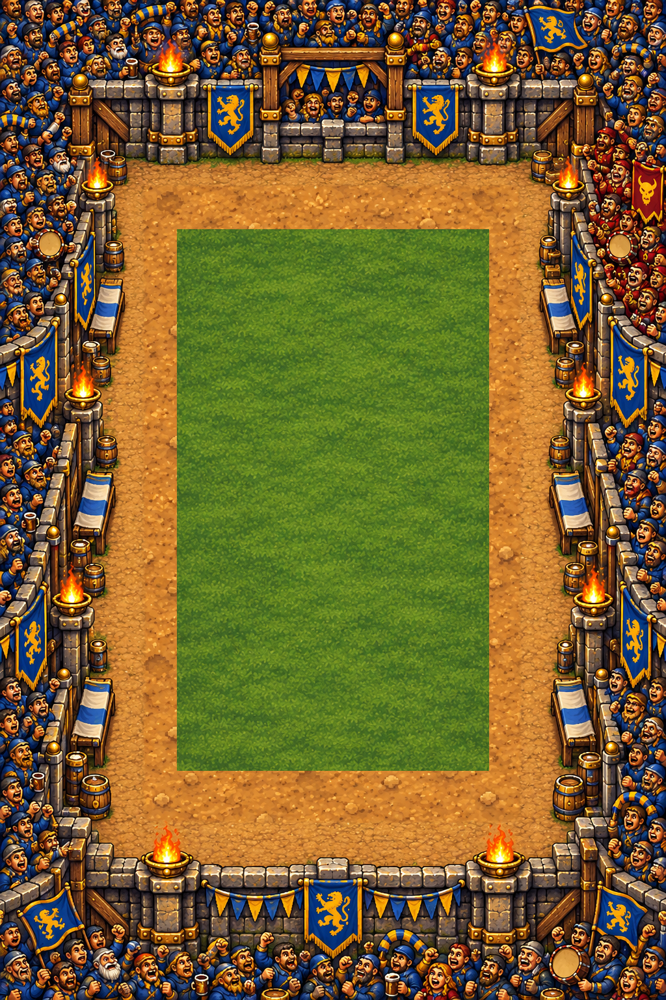
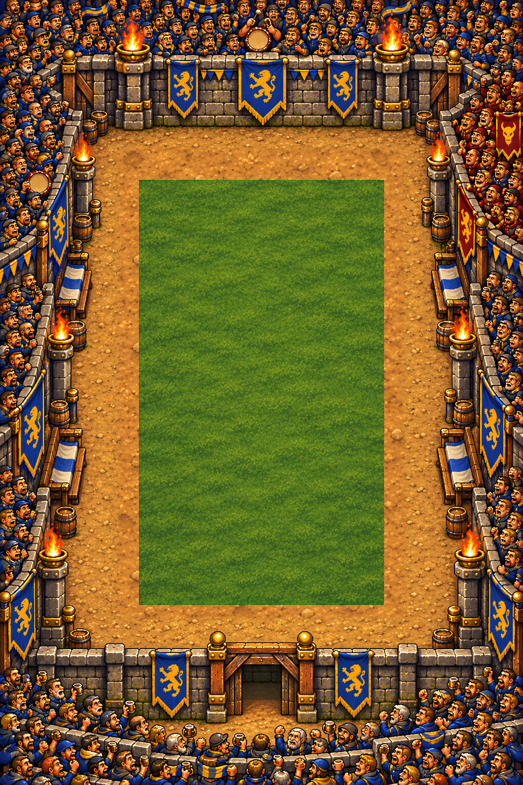
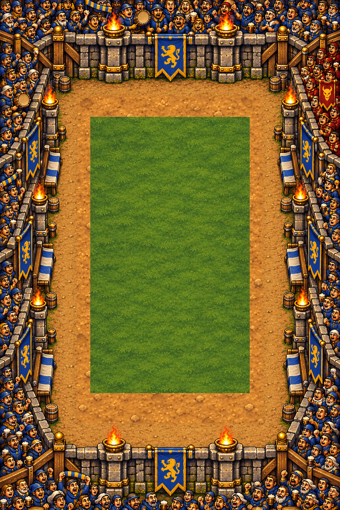
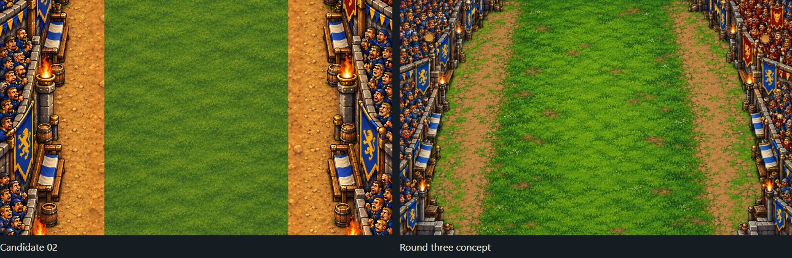
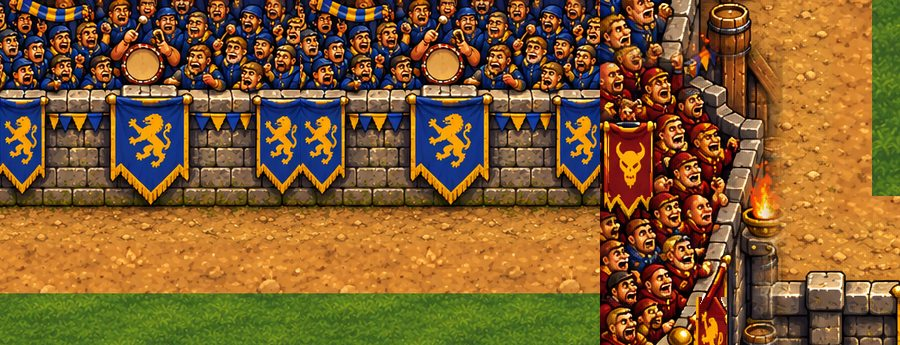
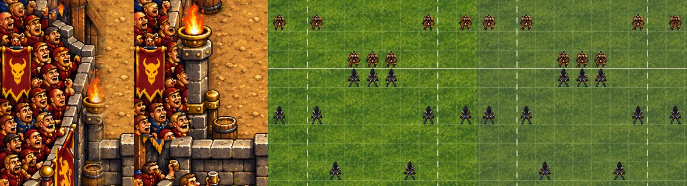

# Old World Classic stadium, round four

## Accepted Gatehouse kickoff gallery

The owner accepted the 790 × 1188 overhead Gatehouse gallery as the basis for live integration. The kickoff shows 22 players and 193 supporters across 15 seating bays. The four east bays hold the visitors, and 64 supporters wear neutral outfits. [Issue #572](https://github.com/the-grognard-codes/moles-under-the-pitch/issues/572) · [PR #580](https://github.com/the-grognard-codes/moles-under-the-pitch/pull/580) · [Final kickoff overview](../../assets/game/references/stadiums/scale-studies/kickoff.webp) · [Seating and colour details](gatehouse-scale-studies.md#full-stadium-at-kickoff)

The weathered end zones use the defending teams’ colours and names, with worn spots exposing grass or paint. The dirt apron reserves space for both teams’ sideline staff and reserve players, plus cheerleaders on all four sides. The south gate lane stays clear. At both diagonal locker-room entrances, the shared stair sprite’s exposed treads widened from about 17 to 20 native pixels across. The flights descend into torchlit landings beneath the northwest and southeast walls. [End zones in three palettes](../../assets/game/references/stadiums/scale-studies/end-zones.webp) · [Apron reservation map](../../assets/game/references/stadiums/scale-studies/apron-reservations.webp) · [Both stair joins at 4×](../../assets/game/references/stadiums/scale-studies/locker-stairwell-detail.webp)

### Review locally

From `browser-client`, run `npm run dev:stadium` and open `/stadium-mockup`. It opens on **Full stadium · Kickoff**. For a closer look, select **Inspect a bay** or open `/stadium-mockup?view=full-bowl&bay=6#bowl-detail` for west bay 6 at native size and 4×.

- Use **Regalia** and **End zones** to toggle each layer independently. Choose a review palette under **End zone and regalia colors**.
- Use **Seat markers** for hip and boot contacts, knees and vacant seats, and **Bench tops** to inspect the planks.
- Use **Apron reservations** in the full or empty stadium, or open `/stadium-mockup?view=full-bowl&reservations=1`. The **Gallery view** menu also opens the empty bowl, seating masks and earlier crowd studies. The end-stand kickoff and pose showcase have direct routes at `/stadium-mockup?view=full-ends` and `/stadium-mockup?view=end-poses`.

Run `npm run test:stadium-mockup` from `browser-client` to exercise the current gallery and write browser captures under `.tools/stadium-mockup/`.

### Live match follow-up

The playable 90° camera uses the stadium with the match teams’ names and kits. Both captures below show the same real dev-local kickoff from opposite coach ends. The gate stays at the bottom, while the visiting bays and defending teams’ end zones change sides. A separate authenticated browser run advanced through setup, kickoff and a confirmed move. The away view is awaiting owner approval. [Integration issue #605](https://github.com/the-grognard-codes/moles-under-the-pitch/issues/605) · [Home kickoff](../reviews/gatehouse-overhead/kickoff-home.webp) · [Away kickoff](../reviews/gatehouse-overhead/kickoff-away.webp)

## Original painting and reconstruction

**Approved still: 02, Gatehouse.** On November 18, 2026, the owner selected the open near gate because it helps orient the viewer. The source for extraction is the approved 1024 × 1536 painting, stored in lossless WebP, SHA-256 `5f212289b0fb4a783176e4e4b93b226f32abfc81376a7c8bf883c0a83e72242c`. [Approval record](https://github.com/the-grognard-codes/fumbbl-rebuild/issues/572#issuecomment-6988171353)

| 01 · Drummers | 02 · Gatehouse | 03 · Lion wall |
| --- | --- | --- |
|  |  |  |
| Drummers flank the touchlines and a timber booth breaks up the far wall. | The broad far banners, alternating torch pillars and open near gate distinguish the two ends. | A compact visiting block and a single lion on each end wall give the cheering figures more room. |

### What to compare

#### Approved neutral crowd clothing

The owner approved the fixed umber, tan, warm grey and charcoal mix on November 18. It covers 75 home supporters and eight visitors. A native one-bit mask keeps all 20,082 selected garment pixels out of the team-colour ramps before the layers are cut for either coach end. The revised Gatehouse still is the gallery comparison target. [Earlier painting](https://github.com/the-grognard-codes/fumbbl-rebuild/blob/55db1cf9b/assets/game/references/stadiums/round-four/candidate-02.png) and [approved revision](../../assets/game/references/stadiums/round-four/candidate-02.webp).

Candidate 02 comes closest to the concept's foreground wall depth, hanging cloth and readable faces. Three differences remain visible. The sideline faces are larger and the bays repeat more regularly. The turf meets the apron at a sharper edge. Showing both end walls makes them more prominent than in the owner's cropped reference. The centre crop misses the red block at upper right, which is visible in the full still. Judge the face scale and wall rhythm using the cropped concept, then look at the full frame to judge the end walls. [Owner's concept](../../assets/game/references/stadiums/concept-round-3/01-old-world-classic-human-home.webp)

### How the stills were made

The earlier modular gallery split crowds into bands. Its overhead rendering showed heads from above, and its review captures missed the Orc team. This round starts from the home-end overhead gallery capture. Each candidate was painted as one scene using that capture, the owner's concept and the architecture sheet from #571. The crowd and walls retain the original positions, pixel density and lighting of each painting. [Previous review](https://github.com/the-grognard-codes/fumbbl-rebuild/pull/571#issuecomment-6938352174)

The native frame is 1024 × 1536 at 32 pixels per square. The playable rectangle starts at (272, 352) and ends just before (752, 1184). The raw paintings extended grass into the apron. A painted ochre ground sample fills the excess grass and the original grass fills the exact playable rectangle at 80% contrast. All source rasters and final pixels are native size. The preparation script works on the complete still, and lives beside the lossless source images, prompts and input references. [Layout capture](../../assets/game/references/stadiums/round-four/layout-base.png) · [Generation record](../../assets/game/references/stadiums/round-four/generation.json) · [Ground preparation](../../assets/game/references/stadiums/round-four/prepare.py)

The original 640 × 960 neutral-clothing preview is archived alongside its full-size approved painting. [Historical preview](https://github.com/the-grognard-codes/moles-under-the-pitch/blob/8d27925bb2445ff7bc0e01b42be457c7d14b937f/assets/game/references/stadiums/round-four/neutral-crowd-preview.webp)

### Historical gallery and validation

The original painting gallery formerly used `/stadium-mockup` and exercised both coach ends, pan and zoom, Human and Orc teams and colour pairs. The current dev route opens the kickoff gallery above. The full-resolution stills and comparison captures preserve the earlier review.

The pre-approval checks passed all 555 browser tests and 31 asset checks, TypeScript, the production build, and the gallery, projected-pitch, playback and playback-motion drivers. The gallery driver verified 22 loaded player images and the complete 390-square grid. The native layout reproduced byte for byte. The driver also exercised the approved layered stadium with both teams, both turf presets, five colour pairs, all visibility toggles, both ends, 50%, 100% and 200% zoom, and pan.

### Reconstruction review

#### First cut

The approved still, first home reconstruction and away visiting-section detail appear below, left to right. A native Chromium screenshot changed 3,622 of 1,173,504 outside-pitch pixels (0.309%). All 399,360 pitch pixels matched. The largest differences were alpha rounding at the home visiting-section edge, a second torch in the relocated section and a banner crossing the near wall. This prompted an opaque home cut and a tighter away supporter silhouette.

The game-service build passed all 29 tests on the pinned JDK and Maven. The game server packaged successfully in quick mode. All 15 validation-inventory tests passed after the gallery driver was registered as a standalone development check.

#### Final cut

The home screenshot now matches the approved still in **all 1,572,864 pixels** at 100% zoom with the balanced turf, original colours, grid off and players off. An independent RGB comparison of the Chromium screenshot counted zero changes inside the pitch and zero in the 1,173,504 outside pixels. The cut script also checks a fresh reconstruction against the approved painting. [Layer recipe and manifest](../../assets/game/references/stadiums/round-four/layers/manifest.json)

The intended differences in the other views are visible below. First, the relocated away supporters use the destination's torch, wall and barrel. The visiting section moves from upper right to lower left, the gate stays at the bottom and the heraldry reads upright. Second, the calm preset reduces turf contrast across the 399,360 playable pixels with zero changes elsewhere. Third, changing the visitor or kits changes the crest, the selected cloth and the player uniforms. The Human visiting standard uses a lion taken from the same painting. The native balanced view retains the original visiting standard.

The original gallery could cross-fade the reconstructed render against either the approved full still or the cropped concept. The automated check compared both endpoints and the midpoint. The archived thumbnail shows the midpoint against the approved still. [Home cross-fade](../../assets/game/references/stadiums/round-four/home-crossfade.jpg)

**Angled cameras.** The original gallery’s 30, 40 and 50 degree views showed turf. The approved painting uses upright faces and banners on both sidelines. A perspective stadium needs its own visual target before work starts on angled architecture or crowds.

## Earlier kickoff proofs

The regalia proof added 25 team-coloured standards, pennants, swags and shields. Against that kickoff, the weathered paint changed 14,301 pixels in the north touchdown row and 13,845 in the south. The worn patches exposed 83 pixels of the original grass in the north and 75 in the south. In each club name, 22 formerly inked pixels showed the surface beneath. All chalk and every pixel outside the two rows matched the prior kickoff. Turning off the paint restored the full 790 × 1188 frame exactly.

Native pixel checks of the apron layout confirmed clearance from the pitch, fixed art and south gate lane. Switching the gallery guide off reproduced the approved weathered kickoff exactly. [Reservation guide](gatehouse-scale-studies.md#pitch-apron-reservations)

The first northwest stairwell proof added 727 pixels to the dirt apron. Replacing its bench and pegs with a passage turning into darkness changed 78 pixels. The placement review then fitted the stairs beneath the northwest wall and added a rotated copy beneath the southeast wall. Chromium measured 825 changed pixels at the northwest corner and 871 at the southeast corner against the single-entrance proof. All other pixels matched in the empty stadium and at kickoff, with the reservation guide both on and off. [Both corner joins at 4×](gatehouse-scale-studies.md#corner-locker-room-stairs)
