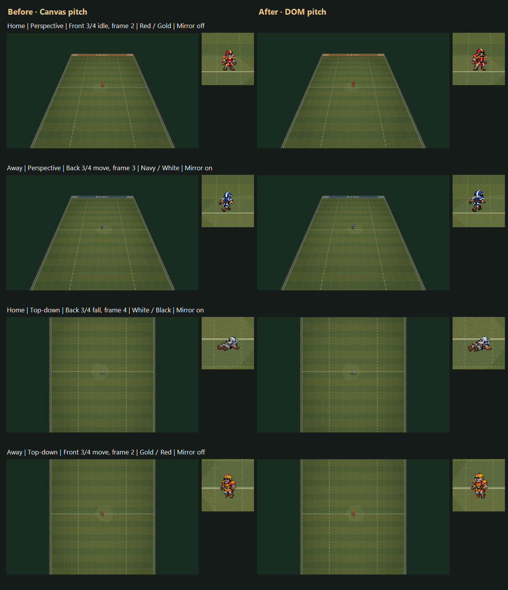

# Remove PixiJS from the browser client

Projected sprite review now uses DOM images, the live pitch projection, player placement anchors and live 1.08 sprite scale. The previous proof used a scale of 1.0. The development page retains its controls, including the native-size frame canvas and palette sheet. ADRs 0003 and 0011 record the removal. [Issue #615](https://github.com/the-grognard-codes/moles-under-the-pitch/issues/615) and [design mirror](remove-pixi.md).

## Visual comparison

Four paused lineman frames cover idle, move and fall, both coach ends, both projections, mirroring and four kit pairs. Each pair shows the full pitch and an enlarged detail. Recoloring, facing and registration against the field agree across the samples. The DOM images are 8% larger to match live play.

## Measurements

Windows, Node 26.12.1, npm 11.20.0. Install size sums the file lengths in a fresh browser-client node_modules directory. The bundle measurements cover the Vite production entry and stylesheet.

| Measurement | Before | After |
| --- | ---: | ---: |
| Installed package files, bytes | 175,418,005 | 93,426,336 |
| Packages installed | 37 | 25 |
| game.js, bytes | 1,081,640 | 1,081,640 |
| game.css, bytes | 175,653 | 175,653 |

Headless Chrome 158.0.8127.36, 22 players, last 600 frames of each ten-second run. Frame interval measures time between animation callbacks. CPU measures synchronous work inside the callback. Browser paint and compositing happen separately. These are local observations under concurrent validation.

| Scene | Median / p95 interval, ms | Median / p95 CPU, ms |
| --- | ---: | ---: |
| Original animated | 6.10 / 6.20 | 0.20 / 0.30 |
| DOM animated | 6.10 / 6.60 | 0.30 / 0.90 |
| Original static | 6.10 / 6.20 | 0.10 / 0.20 |
| DOM static | 6.10 / 6.30 | 0.20 / 0.50 |

## Retired files

Paths are relative to browser-client. The [September comparison](../../.notes/overhaul-analysis/m5-renderer-parity-review-2026-09-24.md) retains the original evidence.

| Removed | Disposition |
| --- | --- |
| src/PitchParityPreview.tsx | The development router now handles the old URL like any unknown route. |
| src/pitch-parity-pixi.ts | Retired the comparison board. |
| src/pitch-parity.css | Retired comparison-only layout and controls. |
| src/pitch-parity-model.ts | Retired the comparison's scripted fixture. |
| test/pitch-parity-model.test.ts | Retired tests for that fixture. |
| test/pitch-parity-demo.mjs | Historical screenshots remain in the September evidence. |
| test/pitch-parity-measure.mjs | Historical renderer measurements remain in the September evidence. |

The independent projection inventory script still reads saved server fixtures. The live match renderer, stadium studies and asset pipeline have no code changes.

## Validation

- Clean npm install and production build passed. The dependency tree is empty for pixi.js and the browser source, tests and package manifests contain no matches.
- All 586 browser-client Node tests, 32 asset checks and 11 focused sprite tests passed. The asset check verified 594 delivered assets.
- Both Playwright sprite suites passed on Windows Chrome. The final full UI run recorded 6.10 ms median and 6.20 ms p95 intervals in both 22-player scenes, with 24 cached images for animation and 22 static fallbacks. Linux browser execution was not measured locally.
- A browser navigation check confirmed the retired URL and a fresh unknown URL both redirect to the same play URL with query string and fragment preserved.
- Dev-local started in quick mode. The hosting proxy reached the Java authentication gate on initial connection and reconnect. Local startup used the primary checkout's schema-10 index check, which is separate from this change.
